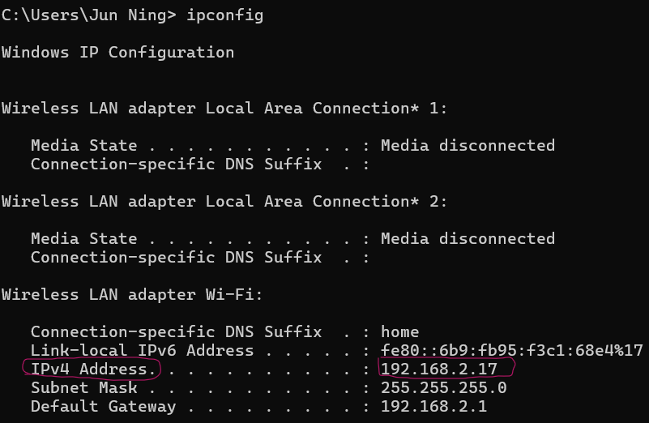

# Welcome to your Expo app 👋

This is an [Expo](https://expo.dev) project created with [`create-expo-app`](https://www.npmjs.com/package/create-expo-app).

## Get started

1. Install dependencies

   ```bash
   npm install
   npm install expo-constants
   ```
these packages need to be installed in the terminal: 
* npm install axios expo-image-picker expo-router firebase ,
* npm install @aws-sdk/client-s3 ,
* npm install react-native-get-random-values,
* expo install expo-linear-gradient ,
* npm install @expo/vector-icons ,
* npm install @react-native-picker/picker
* npm install react-native-keyboard-aware-scroll-view

2. Please add your IP ADDRESS to the  IP_ADDR variable below like (eg: IP_ADDR=191.178.1.2)

   you can get your IP address by typing ipconfig in your commmand Prompt: (ipv4 address)
   
    
   
```bash
   IP_ADDR=
````

4. Start the app

```bash
   npx expo start
```


